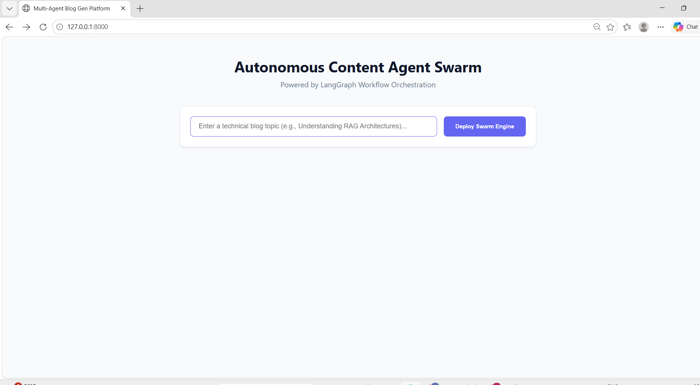
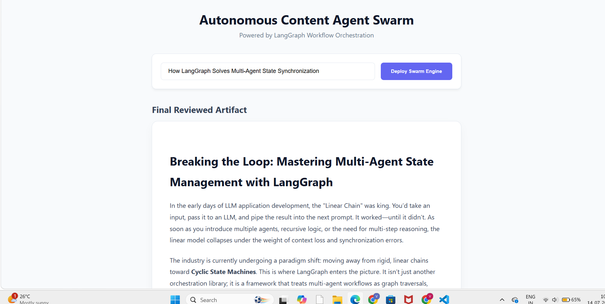

# Multi-Agent Blog Generator

A LangGraph multi-agent workflow that researches a topic, writes an SEO-friendly HTML blog post, and has an editor agent review it, looping back to the writer with feedback until the draft is approved or a revision limit is reached. Served through a FastAPI web app.

## Architecture

```
START -> Researcher -> Writer -> Editor --approved / max revisions--> END
                         ^          |
                         +-feedback-+
```

| Agent | What it does |
|-------|--------------|
| **Researcher** | Searches the live web with Tavily (if `TAVILY_API_KEY` is set) and builds grounded research notes with source URLs. Falls back to the LLM alone if search is unavailable or fails. |
| **Writer** | Turns the notes (and any editor feedback) into a clean HTML article. |
| **Editor** | Returns a structured verdict (`score` 1-10, `approved`, `feedback`) using Pydantic structured output. A draft is approved only if the editor approves **and** the score meets `APPROVAL_SCORE`. |

Shared state is a typed `BlogState` (`state.py`). The conditional edge stops after `MAX_REVISIONS` so the loop always terminates.

## Tech stack
LangGraph, LangChain, Gemini API, Tavily, FastAPI, Pydantic, Jinja2, Docker, pytest

## Improvements in this version
- Real Tavily web research (the previous Researcher used the LLM only), with source links shown in the UI
- Structured editor output instead of string-matching "APPROVED"
- `build_graph(llm, search_fn)` factory, so the workflow is testable without API keys
- Unit tests for approval, feedback loop, revision cap, search success and search failure
- LLM HTML is sanitized with `nh3` before rendering
- Blocking graph call moved off the event loop; error handling and `/health` endpoint
- `requirements.txt`, `.env.example`, Dockerfile

## Run locally
```bash
git clone https://github.com/vivek65666/multi-agent-blog-gen.git
cd multi-agent-blog-gen
python -m venv .venv && source .venv/bin/activate
pip install -r requirements.txt
cp .env.example .env   # add GOOGLE_API_KEY (and optionally TAVILY_API_KEY)
uvicorn app:app --reload
```
Open http://127.0.0.1:8000

## Run tests
```bash
pytest -q tests
```

## Run with Docker
```bash
docker build -t blog-gen .
docker run -p 8000:8000 --env-file .env blog-gen
```

## Screenshots


